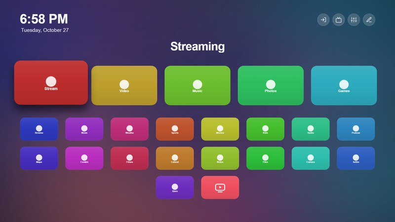
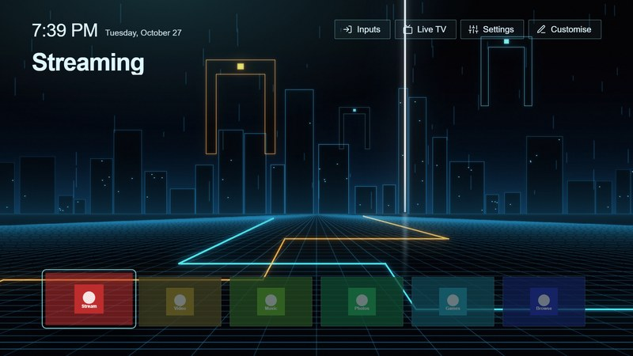
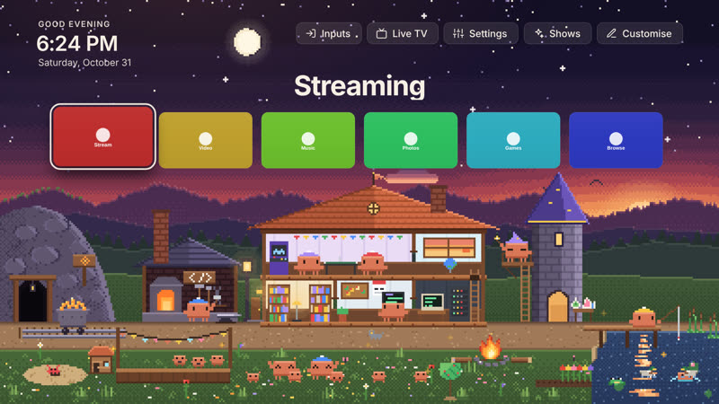

# Themes

The themes of CleanYourTV. A theme changes how the home screen looks: colours, the position and size of the clock, buttons, app name,
dock and grid, text, effects and a wallpaper. In the manager app, **Theme** lists them with these screenshots; the TV reads this folder
from GitHub (the `main` branch) and downloads a theme when you choose it. A new theme is available to every TV as soon as it is merged,
without a release.

| File | What it is |
|---|---|
| `index.json` | The list the TV downloads. Generated: `node tools/theme-index.js`. |
| `<id>/theme.json` | The theme: colours, positions, sizes, effects. Every key is optional. |
| `<id>/preview.jpg` | The screenshot shown in the manager. |
| `<id>/<wallpaper>` | The wallpaper, if the theme uses one. |
| `<id>/<typeface>` | A typeface (`type.fontFile`), if the theme uses one, with its licence file. |
| `<id>/<mascot>` | The mascot's picture (`mascot.file`), if the theme has one: a strip of frames that the launcher walks along the bottom. |
| `<id>/<sprite sheet>` | A world's sprite sheet (`world.file`), if the theme has a world: every frame of its characters, props and particles. |

Every setting, with its range and default, is in the [Themes page of the documentation](https://lasharor.github.io/cleanyourtv-WebOS/themes/).

## Make your own

A step-by-step guide, including how to make one with an AI assistant, is on the [Themes page](https://lasharor.github.io/cleanyourtv-WebOS/themes/#making-a-theme-with-an-ai-assistant). The short version:

1. Copy a folder, for example `classic/`, to `<id>/` (lower-case letters, digits and `-`).
2. Change only what you want to change in `theme.json`. A missing value keeps the default, or the value of the theme named in `"extends"`.
3. Put a screenshot of the result in `preview.jpg` (16:9, about 800 px wide, at most 600 KB). `node tools/theme-preview.mjs <id> --write` makes it.
4. If it uses a wallpaper, put a `.jpg`, `.png` or `.webp` (at most 1.5 MB, 1920 x 1080) in the folder and name it in `effects.wallpaper`.
5. Run `node tools/theme-index.js`, then `node tools/test.js theme`.
6. Open a pull request. A wallpaper or typeface must be your own work or under a licence that allows redistribution; say which,
   and put a typeface's licence file in the folder.

## The themes

### Classic

The original look: near-black, white focus, ten columns.

Folder: [`classic/`](classic/)

### Bloom

A flower wallpaper with the dock in a glass panel at the bottom. Down moves the dock up and the apps appear below it, centred.

Folder: [`bloom/`](bloom/)

### Lock Screen

A phone-style lock screen: a greeting and a big clock top left, and a small, translucent dock low in the corner over a calm blue landscape, so the picture fills the screen. Down moves the dock up and shows all apps below it. Turn Wallpapers on in Customise for your own photos behind it. It has slots for cards (Customise > Cards): the greeting is one.

Folder: [`lockscreen/`](lockscreen/)

### Horizon

A row of seven square apps along the bottom of a dusk landscape, the clock on the left and the buttons on the right at the top. Down moves the row up and shows all apps below it.

Folder: [`horizon/`](horizon/)

### Pixel

Pixel art: a blocky typeface, square tiles and buttons, a yellow focus box and a sunset over a lake drawn in big pixels. Moves without animation, like an old console.

The typeface is Pixelify Sans (weight 500, Latin, unmodified), in the folder as `pixel.woff2` under the SIL Open Font License 1.1
(`OFL.txt`); the wallpaper was drawn for this theme.

Folder: [`pixel/`](pixel/)

### Compact

Twelve columns of smaller tiles: more apps on screen.

Folder: [`compact/`](compact/)

### Large print

Eight columns of big tiles and bigger text, easier to read from the sofa.

Folder: [`large/`](large/)

### Midnight

Deep blue with a soft wallpaper and a blue focus.

Folder: [`midnight/`](midnight/)

### OLED black

Pure black, no ambient glow: unlit pixels stay off.

Folder: [`oled/`](oled/)

### Still

No animation and a quiet glow, for anyone who prefers a calm screen.

Folder: [`still/`](still/)

### Warm

Brown and amber with the glow in the accent colour.

Folder: [`warm/`](warm/)

### Cupertino

A living-room lock screen in the manner of Apple's TV, after the Night look of [couch-tv](https://github.com/seagey/couch-tv): a huge,
thin, translucent clock with a light rim in the sky over a night lake, the date above it, one round button top right, and a smoked-glass
dock of square icons along the bottom with a white ring on the focused one. Down moves the dock up and shows all apps below it; the
clock fades out meanwhile. The scene, `night.jpg`, is couch-tv's `scene-night.jpg`, made for couch-tv with an image model from text only
(not a real place) and released for any use (its `backgrounds/CREDITS.md`); it drifts slowly, as theirs does (`effects.drift`). The
clock's typeface is Antonio (weight 300, Latin, unmodified), `antonio.woff2`, under the SIL Open Font License 1.1 (`OFL.txt`); the rest
of the text keeps the TV's font.

Folder: [`cupertino/`](cupertino/)

### The Grid

The world of the Grid, in the spirit of the 2010 light-cycle film, going on behind Home: light cycles race the floor in cyan and
orange, near and far, turning at right angles and leaving walls of light along every stretch until they derezz and the walls fade
(`effects.cycles`); Recognizers, the big ships, drift across the sky; the portal beam pulses up from the city into the clouds; light
rains down and pulses of light sweep the floor (`effects.scene` `lightcity`). The backdrop, drawn for this theme, is the city: a
monumental dark structure edged in orange with a bright gate at its foot, towers with light strips tapering into the haze, clouds lit
from below and a wet floor that mirrors it all. Six smoked-glass tiles edged in light stand on the floor, the focused one with a thin
light-blue ring; the buttons are outlined boxes and the glow is cyan. Down moves the row up and shows all apps below it.

### Terminal

Just a terminal, no launcher to see: green phosphor text on black in a monospace typeface. `$ date` prints the time and the date,
`$ open ` is followed by the focused app's name and a blinking block cursor, and under `$ ls apps/` every app is a line of its own,
the focused one in inverse video with a `> ` marker (`tile.style` text, `dock.show` off, one column). The top buttons are plain words,
the menus have square rows, and behind it all are scanlines, faint character columns and the soft curve of a tube, drawn for this
theme (`terminal.png`).

Folder: [`the-grid/`](the-grid/)

### Claude

Clawd World: a pixel village where the little Clawds of Claude Code live, going on under the apps (a world, `world` in `theme.json`;
see the [Themes page](https://lasharor.github.io/cleanyourtv-WebOS/themes/#a-world)). The greeting and the clock sit in the sky, the
focused app's name is big above a row of six apps, and Down opens all the apps over the village, which pauses under them. The village
keeps the hours of the TV's clock: by day a blue sky with the sun high, the mountains, the hills and the pond in daylight and white
clouds; from six the sun goes down behind the hills, the sky turns red and purple and the stars and the moon come out, the moon in its
real phase that night; from nine a deep night sky, the lamps and the windows lit; at five the dawn. Each sky fades into the next over a
few minutes.

Every day has its own weather, picked from the date (not the weather outside), the same all day: mostly sunny, with butterflies in the
warm months and a balloon drifting by; some days grey with clouds, or windy with gusts every few seconds; on a day of rain (spring to
autumn) showers come again and again and send everyone indoors, puddles ripple on the street, and after a shower by day a rainbow rises
behind the village; some mornings a bank of fog hides the mountains and wisps of mist drift past until noon; in winter, often snow
falling all day, and nearly always at Christmas.

Eight Clawds, each in a beanie of its own colour and each with a name (Byte, Pixel, Moss, Nova, Spark, Sunny, Mochi and Tink) and a
favourite kind of spot (Byte codes, Pixel games, Moss is happiest outdoors, Nova likes magic, Spark and Tink build things, Sunny puts
on shows, Mochi likes it cosy), walk the village street from spot to spot and get on with things. In the house they go in at the door
and climb the ladder: reading in the library, pinning notes and stamping mail in the workshop, coding at the desk and at the terminal,
debugging in the server room, playing the arcade, pong, jump rope or the block tower in the game room upstairs (the first one there
waves the others over with a "!" until they come, and the table, the rope or the tower comes out when they are all there), gazing out
of the lookout, and at night four of them sleep up there. Outside they hammer at the anvil of the Code Forge, swing a pickaxe at the
Token Mine and go in past the cart to come back pushing it, cast spells from the wizard's tower, have a eureka at the lab, fish off the
pier, conduct the choir on the stage, juggle, sweep, build, water the garden, have a coffee, roast marshmallows by the campfire, dance
in the meadow with hearts between them, burrow into the sand to pop up again, or wander off the edge of the world and back. They say
what they are up to in little speech bubbles (code, a bug, an idea, a heart), and now and then two of them meet in the street, say each
other's name, chat and clap. They hop when you move the focus, and two of them wave hello when you come back to Home and goodbye when
you open an app. They keep a routine at their own hours, not the clock's: stretches and coffee together, marshmallows round the
campfire, a picnic, tea for two. Five little Clawds play in the meadow, a crab scuttles on the sand, a cat strolls the street by day
and an owl by night, two ducks paddle about the pond and dive, and a frog hops off its lily pad now and then.

Now and then something happens: a game of volleyball in the meadow, a party on the stage in the evening with fireworks and confetti, a
juggling show, a flying saucer or a meteor shower at night (with a crowd pointing at it), a deer looking out of the bushes, or the
server room overheating. Some things are rare: a dragon that flies over, lands on the mine's rock, looks about, roars a jet of flame
and flies off, a golden Clawd running along the street, a comet crossing the night sky, the northern lights on a winter night, a
balloon festival on a sunny day. The hours change things too: the night darkens the sky, the lamps glow, fireflies come out in summer,
a sparrow sits on the sill by day; and so does the year: blossom on the trees in spring, the trees red and gold in autumn, snow on the
ground and the roofs and a snowman in winter. The holidays come round: Halloween all October (witch hats, pumpkins, cobwebs, bats and
ghosts at night); Thanksgiving and Christmas both in November (pilgrims' and Santa hats in turn, a turkey strutting about, the harvest
by the stage, a feast at a long table, the Christmas lights going up); Christmas all December (Santa hats, lights along the eaves, a
wreath round the round window, presents under the fir, and Santa's sleigh landing on the roof at night); rockets at midnight on New
Year's Eve and party hats on New Year's Day; the Lunar New Year (red lanterns along the eaves, red and gold caps, a lion dancing down
the street, firecrackers), Valentine's week (red caps, hearts), St Patrick's Day (green caps, shamrocks, a rainbow with a pot of gold),
Easter (bunny ears, painted eggs, an egg hunt), the Fourth of July (red and blue caps, fireworks at night) and the Mid-Autumn Festival
(lanterns, tea under the full moon). The feasts that move from year to year (the Lunar New Year, Easter, the Mid-Autumn Festival) come
on their own days each year. By the house a shed goes up over the week (begun on Monday, done on Sunday) and a sapling grows over the
month. Around them the fire crackles and throws embers, smoke rises from the chimneys, a fish jumps, a Clawd swims in the pond, and
clouds, birds and a balloon drift past behind the roofs. Every half minute or so a gust of wind sweeps across from the left: the
flowers of the garden and the meadow, the grass, the reeds and the bunting bend in a wave as it passes, the flag on the roof streams
out, the lily pads drift and a few petals are carried off; rings spread on the pond. Overhead the stars and the moon wheel slowly
across the sky and back, the bright stars twinkle, others flare now and then, and a star shoots across.

The **Shows** button in the top row of Home starts a show and gives it the screen: fireworks (rockets bursting all over the sky), a
rain shower, a dance party, a snow flurry, a flying saucer, the dragon, the golden Clawd, a balloon festival. On a remote with the four
coloured buttons, red, green, yellow and blue start the first four. The clock, the buttons and the apps fade away while a show lasts
and come back when it is over or at any key. After a minute and a half without a key they fade away too and the village has the screen
(watch mode); any key brings them back.

Everything was drawn for this theme pixel by pixel by `tools/clawd-world/` (`node tools/clawd-world`), which writes `world.png` (the
backdrop, 384 x 216 art pixels at five times), `clawd.png` (the sprite sheet: every Clawd in every cap) and the `"world"` of
`theme.json` from the same layout. It redraws parts of three MIT-licensed Clawd projects: the house, the Clawd's poses, the games, the
pals and the visitors of clawd-sidekick, the jobs of Clawd Tank, and the meadow and the bubbles of claude-clawd (see
[THIRD-PARTY.md](../THIRD-PARTY.md)). It is also inspired by ClaudeVille's Code Forge, Token Mine and Research Lab. The character is
Clawd, the mascot in Claude Code's terminal (a block with two eyes, little arms and four legs; Anthropic's character).

Folder: [`claude/`](claude/)
